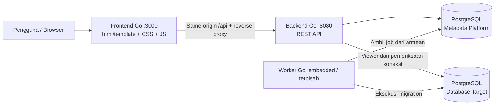
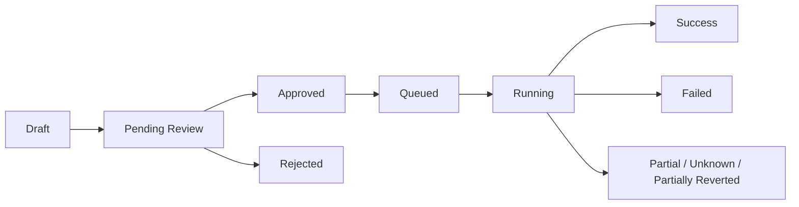

# Terserah — Database Management Platform

Terserah merupakan aplikasi web untuk pengelolaan akses database pada Tugas Besar IF3110 Pengembangan Aplikasi Web — Milestone 2. Aplikasi menyediakan autentikasi, manajemen pengguna dan grup, pengaturan hak akses database, pengelolaan koneksi PostgreSQL, penjelajahan skema dan data, serta pembuatan dan pelacakan riwayat migration. Pada Milestone 2, aplikasi dikembangkan menjadi Single-Page Application (SPA) dengan workflow review dan approval, eksekusi migration secara asynchronous, rollback dan forward, pemrosesan batch dengan checkpoint dan recovery, serta structured logging dan tracing.

## Identitas

Kelas: K2

Kelompok: 06 - Terserah

| Nama | NIM |
|---|---|
| Niko Samuel Simanjuntak | 13524029 |
| An Dafa Anza Avansyah | 13524038 |
| Raymond Jonathan Dwi Putra J | 13524059 |

## Menjalankan Sistem

### Prasyarat

- Go 1.26.2 atau lebih baru.
- PostgreSQL yang berjalan dan dapat diakses dari komputer pengembang.
- Node.js untuk menjalankan tes JavaScript frontend.

Aplikasi secara bawaan dijalankan sebagai dua proses Go: backend pada port `8080` dan frontend pada port `3000`. Worker migration berjalan di dalam proses backend atau dapat dijalankan sebagai proses Go terpisah.

### Menjalankan dengan skrip Windows

Dari root repository, jalankan FE dan BE sekaligus dengan satu perintah:

```powershell
.\dev.cmd
```

`dev.cmd` menjalankan `dev.ps1`. Saat `.env` belum tersedia, skrip menawarkan setup PostgreSQL lokal dan meminta akun admin pertama. Untuk database yang sudah ada, siapkan `.env` sesuai bagian manual di bawah. Skrip memuat konfigurasi, menjalankan migration metadata, memeriksa akun admin, lalu menjalankan layanan. Buka `http://localhost:3000/login` dan tekan `Ctrl+C` pada terminal untuk menghentikan layanan yang dimulai oleh skrip.

Pilihan lainnya dari root repository:

```powershell
.\dev.cmd fe      # Jalankan frontend saja; backend harus dijalankan terpisah
.\dev.cmd be      # Jalankan backend saja
.\dev.cmd setup   # Siapkan database lokal baru; hanya jika .env belum ada
.\dev.cmd admin   # Siapkan admin pertama jika belum ada
```

Untuk setup otomatis, PostgreSQL harus berjalan dan `psql` harus tersedia di PATH. Setup membuat database metadata dan dua database target lokal; kredensial target disimpan di `tmp/dev/database-credentials.txt`. Jika nama database atau role yang diperlukan sudah digunakan, setup berhenti tanpa menimpanya. Log layanan berada di `tmp/dev/`.

### Menjalankan secara manual

Langkah berikut menyediakan alternatif untuk menyiapkan database, menjalankan migration, dan menjalankan FE serta BE secara terpisah.

### 1. Siapkan database metadata

Database metadata menyimpan pengguna, grup, grant, session, konfigurasi koneksi target, draft, snapshot revisi, review dan approval, job beserta attempt, dan riwayat migration. Database ini harus terpisah dari database target yang dikelola melalui Terserah.

Jika belum memiliki database metadata, masuk sebagai administrator PostgreSQL:

```powershell
psql -h localhost -U postgres -d postgres
```

Kemudian jalankan sekali di `psql`:

```sql
CREATE ROLE platform LOGIN;
\password platform
CREATE DATABASE platform OWNER platform;
```

Perintah `\password` akan meminta password untuk role `platform`. Jika role/database sudah ada, jangan dibuat ulang; gunakan database yang sudah digunakan sebelumnya. Keluar dengan `\q`.

Untuk menjalankan migration pada database target yang disiapkan secara manual, administrator PostgreSQL perlu menjalankan `BE/sql/provision_target_history.sql` pada setiap target menggunakan `psql` dan role executor terbatas yang sudah ada:

```powershell
psql -h localhost -U <admin_target> -d <database_target> -v executor_role=<role_executor> -f BE/sql/provision_target_history.sql
```

Ganti nilai di dalam tanda `<...>` dengan nama yang sesuai. Role executor harus terpisah dari pemilik database dan memiliki izin yang diperlukan untuk migration. Petunjuk lengkapnya berada pada komentar di awal skrip SQL. Jangan jalankan skrip provisioning melalui draft aplikasi. Setup otomatis `dev.cmd` menyiapkan bagian ini untuk target lokal yang dibuatnya.

### 2. Siapkan environment

Dari root repository:

```powershell
Copy-Item .env.example .env
```

Untuk Linux/macOS:

```bash
cp .env.example .env
```

Atur nilai berikut pada `.env`:

| Variabel | Keterangan |
|---|---|
| `DATABASE_URL` | URL koneksi ke PostgreSQL metadata, misalnya `postgres://platform:<password>@localhost:5432/platform?sslmode=disable` |
| `HTTP_ADDR` | Alamat backend; default `:8080` |
| `APP_ORIGIN` | `http://localhost:3000` untuk FE lokal, bukan `http://localhost:8080` |
| `TARGET_CREDENTIAL_KEY` | Kunci enkripsi Base64 dari 32 byte acak, wajib untuk backend API dan worker |
| `FE_HTTP_ADDR` | Opsional, default `:3000` (dibaca proses FE) |
| `FE_BACKEND_URL` | Opsional, default `http://localhost:8080` (dibaca proses FE) |
| `WORKER_EMBEDDED` | Default `true`, API menjalankan dua slot worker. Atur `false` untuk menjalankan worker terpisah. |
| `OTEL_EXPORTER_OTLP_ENDPOINT` | Opsional, kirim trace ke endpoint OTLP/HTTP, misalnya `http://localhost:4318`. Tanpa konfigurasi exporter, span ditulis ke log JSON. |
| `OTEL_EXPORTER_OTLP_TRACES_ENDPOINT` | Opsional, URL khusus ekspor trace OTLP/HTTP, termasuk path `/v1/traces`. |

`APP_ORIGIN` harus sama persis dengan alamat frontend yang dibuka di browser. Misalnya, `http://localhost:3000` berbeda dari `http://127.0.0.1:3000`. Go tidak otomatis membaca file `.env`; environment harus dimuat ke proses saat menjalankan secara manual.

Jika belum memiliki `TARGET_CREDENTIAL_KEY`, generate satu kali melalui PowerShell:

```powershell
$bytes = New-Object byte[] 32
$rng = [System.Security.Cryptography.RandomNumberGenerator]::Create()
$rng.GetBytes($bytes)
$rng.Dispose()
[Convert]::ToBase64String($bytes)
```

Salin hasilnya ke `.env`. Gunakan kunci yang sama pada setiap restart; penggantian kunci dapat membuat kredensial target yang sudah terenkripsi tidak dapat dibaca. Jangan commit `.env`, password, ataupun kunci enkripsi.

### 3. Jalankan migration metadata

Buka Terminal 1 di root repository dan muat environment backend dari `.env`:

```powershell
Get-Content .env | Where-Object { $_ -match '^(DATABASE_URL|HTTP_ADDR|APP_ORIGIN|TARGET_CREDENTIAL_KEY|WORKER_EMBEDDED|OTEL_EXPORTER_OTLP_ENDPOINT|OTEL_EXPORTER_OTLP_TRACES_ENDPOINT)=' } | ForEach-Object {
    $name, $value = $_ -split '=', 2
    [Environment]::SetEnvironmentVariable($name, $value, 'Process')
}

cd BE
go run ./cmd/migrate
```

Migration metadata bersifat idempotent sehingga aman dijalankan kembali saat perlu. Jika sebelumnya sudah berhasil dan tidak ada migration baru, tahap ini tidak perlu diulang.

### 4. Buat akun Platform Admin pertama (hanya instalasi baru)

Dari terminal backend yang sama, jika belum ada admin di database metadata:

```powershell
$env:BOOTSTRAP_USERNAME = 'admin'
$secure = Read-Host 'Password admin awal (minimal 12 karakter)' -AsSecureString
$env:BOOTSTRAP_PASSWORD = [System.Net.NetworkCredential]::new('', $secure).Password
go run ./cmd/bootstrap
Remove-Item Env:\BOOTSTRAP_PASSWORD
```

Jangan melakukan bootstrap ulang jika sudah memiliki akun admin. Password login aplikasi berbeda dari password role PostgreSQL.

### 5. Jalankan backend

Masih pada Terminal 1 di direktori `BE/` dengan environment yang sudah dimuat:

```powershell
go run ./cmd/api
```

Backend berjalan pada `http://localhost:8080`. Periksa kesiapan metadata PostgreSQL melalui `http://localhost:8080/health/ready` (status `ok` jika siap).

### 6. Jalankan frontend

Buka Terminal 2 dari root repository:

```powershell
cd FE
$env:FE_HTTP_ADDR = ':3000'
$env:FE_BACKEND_URL = 'http://localhost:8080'
go run .
```

Buka http://localhost:3000/login di browser. Browser mengakses seluruh API melalui origin FE (`localhost:3000`), yang diteruskan oleh reverse proxy ke backend (`localhost:8080`). Gunakan `localhost` secara konsisten, bukan berganti antara `localhost` dan `127.0.0.1`.

### URL Komponen

| Komponen | URL / Port |
|---|---|
| Frontend / Login | http://localhost:3000/login |
| Dashboard | http://localhost:3000/dashboard |
| Reviews | http://localhost:3000/reviews |
| Database Viewer | `http://localhost:3000/databases/{id}/viewer` |
| Migration Draft | `http://localhost:3000/databases/{id}/drafts` |
| Database Reviews | `http://localhost:3000/databases/{id}/reviews` |
| Jobs | `http://localhost:3000/databases/{id}/jobs` |
| Migration History | `http://localhost:3000/databases/{id}/history` |
| Admin Users | http://localhost:3000/admin/users |
| Admin Groups | http://localhost:3000/admin/groups |
| Admin Database Connections | http://localhost:3000/admin/databases |
| Admin Grants | http://localhost:3000/admin/grants |
| Backend API | http://localhost:8080/api/v1/ |
| Backend Liveness | http://localhost:8080/health/live |
| Backend Readiness | http://localhost:8080/health/ready |
| PostgreSQL Metadata (contoh) | localhost:5432, database `platform` |

## Arsitektur dan Alur



Frontend merender HTML dengan `html/template`. Router SPA mengambil halaman lewat `fetch()` dan mengganti tampilan tanpa memuat ulang dokumen saat login, logout, dan navigasi internal. API menangani autentikasi, akses target, approval, dan antrean. Worker menjalankan migration dan menyimpan hasilnya. Antrean disimpan di PostgreSQL metadata, sedangkan SQL migration dan bukti commit dieksekusi atau disimpan pada PostgreSQL target.

### Authentication dan Authorization

1. Pengguna login melalui `/login` dengan CSRF prelogin, lalu backend membuat session menggunakan cookie `HttpOnly`.
2. `GET /api/v1/auth/me` digunakan untuk memeriksa session pengguna.
3. Platform Admin mengelola pengguna, grup, keanggotaan, leader, koneksi database, dan grant `view`/`edit`.
4. Pengguna biasa hanya melihat database yang diizinkan berdasarkan grant grupnya.
5. `view` dapat membuka Viewer dan History; `edit` juga dapat mengakses Draft dan Execute Migration.
6. Platform Admin tidak otomatis memiliki akses ke isi database target tanpa grant. Keputusan otorisasi tetap berada di backend.
7. Jika pengguna memiliki beberapa grant pada database yang sama, akses efektif menggunakan tingkat tertinggi (`edit` > `view` > tanpa akses).

### Database Viewer dan Migration

1. Admin mendaftarkan koneksi target PostgreSQL melalui `/admin/databases`, menguji koneksi, lalu memberi grant kepada grup melalui `/admin/grants`.
2. Pengguna yang memperoleh grant membuka Viewer untuk melihat schema, tabel, kolom, constraint, index, dan data baris secara *read-only*.
3. Pengguna berizin `edit` dapat membuat atau memperbarui SQL Draft dengan pemeriksaan revision.
4. Pengguna mengajukan revisi untuk ditinjau. Semua leader grup yang punya akses `view` atau `edit` pada target harus menyetujui pengajuan.
5. Pengguna `edit` mengirim revisi yang disetujui ke antrean. API merespons `202 Accepted` dengan ID job. Worker memeriksa ulang izin dan approval, lalu mengeksekusi migration. Halaman Jobs menampilkan progres.
6. History menampilkan hasil dan detail eksekusi. Rollback, forward, dan resume batch mengikuti alur review dan antrean yang sama. Untuk hasil yang belum pasti, Reconcile memeriksa receipt di target dan memperbarui status.

### Migration Workflow dan Approval



Diagram menunjukkan alur utama review hingga eksekusi; status review dan job disimpan secara terpisah. Pengajuan mengikat revision, jenis aksi dan snapshot SQL. Setiap grup yang memiliki grant pada database target, termasuk grup `view`, harus memiliki leader yang memberikan approval. Penolakan mencegah pengajuan dieksekusi. Permission, approval dan posisi migration divalidasi kembali sebelum eksekusi, sehingga approval yang tidak lagi berlaku tidak dapat langsung digunakan.

### Rollback, Forward, dan Migration History

Draft memiliki SQL up dan SQL down, atau ditandai irreversible dengan alasan. Definisi SQL yang telah dieksekusi dibekukan sebagai snapshot revisi. Rollback menggunakan SQL down asli dari migration aktif terakhir yang reversible, sedangkan forward menggunakan SQL up asli sesuai urutan linear. Rollback dan forward memerlukan approval dan dijalankan sebagai job baru, bukan mengubah catatan eksekusi lama.

History menyimpan setiap attempt yang dicatat, termasuk eksekusi gagal, dengan execution ID, versi, revisi, SQL, pengguna, waktu dan status. Status attempt dapat difinalisasi atau direkonsiliasi berdasarkan bukti eksekusi tanpa mengganti SQL historis. Checkbox **Hide Rollback** menyembunyikan pasangan eksekusi yang dibatalkan dan rollback sukses yang membatalkannya berdasarkan execution ID; attempt gagal tetap ditampilkan. Filter tidak menghapus catatan dari database.

### Menjalankan Worker Terpisah

API sudah menjalankan dua slot worker secara bawaan. Untuk memisahkan proses, atur `WORKER_EMBEDDED=false` sebelum menyalakan API. Di terminal baru dari root repository, muat konfigurasi yang sama (termasuk konfigurasi trace jika digunakan):

```powershell
Get-Content .env | Where-Object { $_ -match '^(DATABASE_URL|TARGET_CREDENTIAL_KEY|OTEL_EXPORTER_OTLP_ENDPOINT|OTEL_EXPORTER_OTLP_TRACES_ENDPOINT)=' } | ForEach-Object {
    $name, $value = $_ -split '=', 2
    [Environment]::SetEnvironmentVariable($name, $value, 'Process')
}

cd BE
go run ./cmd/worker
```

Worker terpisah menggunakan antrean metadata dan kunci enkripsi kredensial target yang sama dengan backend. Jika memakai mode ini, pastikan worker berjalan agar job yang berstatus `queued` dapat diproses.

## Fitur Utama

| Area | Fitur |
|---|---|
| Frontend SPA | Navigasi client-side, loading state, serta layout responsif untuk desktop dan mobile |
| Autentikasi | Login, logout, session cookie, CSRF, idle timeout, absolute expiration dan rotasi session |
| Administrasi | Manajemen user, group, membership, leader, dan grant `view`/`edit` |
| Target PostgreSQL | Daftar, tambah, ubah, hapus, dan test koneksi |
| Database Viewer | Schema, table, column, constraint, index, data baris, pagination |
| Migration Draft | Membuat, membaca, mengubah draft SQL dan revision checking |
| Review dan Jobs | Approval per grup, antrean, pemantauan status dan progres |
| Execute Migration | SQL transaksional, batch dengan checkpoint, rollback, forward, dan resume |
| History | Daftar/detail riwayat, cursor pagination, SQL detail, status dan attempt eksekusi, Hide Rollback |
| Activity Logging dan Tracing | Structured JSON log, SQL tracing, korelasi trace API, queue dan worker |
| Reconciliation | Pemeriksaan eksplisit status `running`/`unknown` bagi pengguna berizin `edit` |

## Keputusan Teknis

### Single-Page Application (SPA) dengan Go Templates dan JavaScript ES Modules

Frontend menggunakan Go `html/template` untuk penyajian HTML, vanilla JavaScript ES Modules untuk interaksi, serta CSS untuk tampilan. Asset disematkan ke binary FE melalui `//go:embed templates static`, sehingga perubahan template, CSS, atau JavaScript memerlukan build dan restart FE. Router pada `spa.js` menangani navigasi internal menggunakan Fetch API dan History API. CSS menggunakan media query untuk menyesuaikan layout pada layar kecil; halaman viewer, draft, review, jobs dan history tetap berada dalam alur SPA yang sama.

### Same-Origin Reverse Proxy

Server FE meneruskan `/api/` dan `/health/` ke BE. Browser mengirim cookie session dengan `credentials: "same-origin"`; CSRF token disertakan pada request mutasi. Session tidak disimpan dalam `localStorage`.

### Kontrol Akses dan Keamanan Data

Backend memvalidasi permission untuk setiap operasi. Frontend menyesuaikan navigasi berdasarkan grant untuk UX, bukan sebagai pengganti pemeriksaan backend. Nilai database ditampilkan menggunakan DOM API yang aman, bukan menyisipkan konten tidak tepercaya ke `innerHTML`. Identifier besar dikirim sebagai string.

Session menggunakan opaque identifier melalui cookie `HttpOnly` dan `SameSite=Lax`; atribut `Secure` diaktifkan untuk HTTPS dan HTTP localhost. Parameter session:

| Parameter | Nilai |
|---|---|
| Idle timeout | 30 menit |
| Absolute expiration | 8 jam |
| Rotation interval | 15 menit |
| Grace period | 30 detik |

Rotasi tidak memperpanjang absolute expiration. Backend menangani pencabutan session dan pemeriksaan perubahan privilege. Kredensial database target disimpan dalam bentuk terenkripsi.

### Asynchronous Migration dan Concurrency

Migration dijalankan pada database target yang berbeda dari metadata, dengan role executor PostgreSQL terbatas. Administrator database menyiapkan schema riwayat target. Semua eksekusi melalui antrean persisten; HTTP `202 Accepted` hanya berarti job diterima, bukan SQL berhasil commit. Worker secara bawaan memiliki dua slot eksekusi dengan timeout job 15 menit. Halaman Jobs menampilkan status dan progres, termasuk jumlah batch dan row yang sudah committed.

Antrean menggunakan claim dan lease worker, dengan heartbeat setiap 10 detik dan lease 30 detik. PostgreSQL advisory lock pada koneksi target melindungi satu migration per database, termasuk di antara commit batch; database berbeda dapat diproses paralel. Koneksi pemegang lock ditutup setelah eksekusi, sehingga session lock dilepas. Jika worker berhenti, lease yang kedaluwarsa memungkinkan recovery dengan pemeriksaan bukti pada target sebelum pekerjaan diambil kembali.

### Migration Batch dan Recovery

Migration normal menjalankan SQL dalam transaction tanpa membaginya menjadi batch. Mode batch mendukung UPDATE terstruktur dengan pilihan schema, tabel, kolom primary key integer tunggal yang tidak diubah, nilai kolom yang diperbarui dan batch size (1–5.000 row). Aplikasi tidak memecah sembarang SQL menjadi batch secara otomatis. Mode ini dibatasi pada tabel biasa tanpa trigger yang memenuhi validasi backend.

Cakupan row dibekukan sebelum batch diproses. Setiap batch memiliki transaction sendiri; perubahan dan checkpoint disimpan bersama sebelum commit. Apabila batch gagal, batch sebelumnya tetap committed dan status dapat menjadi `partial`. Resume melanjutkan pekerjaan dari checkpoint tanpa mengulang batch yang telah committed. Pembatalan batch menggunakan kompensasi berdasarkan SQL down yang disetujui dan bukti pemulihan row, dalam urutan batch terbalik. Jika pembatalan gagal sebagian, status `partially_reverted` memungkinkan proses pemulihan dilanjutkan melalui alur yang sesuai.

Worker memakai receipt untuk memulihkan hasil commit dan checkpoint untuk melanjutkan batch dari posisi terakhir. Retry otomatis hanya untuk kegagalan sementara yang memenuhi pemeriksaan bukti, permission dan batas attempt (default tiga attempt), dengan jeda retry. Job dan checkpoint tetap tersedia setelah restart; hasil yang `unknown` atau migration yang masih `partial`/`partially_reverted` menahan migration berikutnya pada target yang sama. Pengguna berizin `edit` juga bisa menjalankan Reconcile dari halaman History untuk memeriksa bukti commit tanpa menjalankan ulang SQL.

### Log dan Trace

Backend dan worker menggunakan `log/slog` dengan JSON handler ke stdout dan OpenTelemetry untuk tracing. Trace context diteruskan melalui antrean agar aktivitas API, worker, lock dan query dapat dikorelasikan. SQL tracer mencatat `sql_started`, `sql_result`, serta hasil transaction secara terpisah, termasuk query read-only dan kegagalan. Tanpa konfigurasi OTLP, span ditulis ke log JSON.

Contoh ilustratif log pengajuan review dan span HTTP dengan trace ID yang sama (ID dan durasi hanya contoh, bukan hasil pengukuran):

```jsonl
{"level":"INFO","event":"migration_review_submitted","actor_id":3,"database_id":1,"review_id":42,"status":"pending_review","trace_id":"0123456789abcdef0123456789abcdef","span_id":"0123456789abcdef"}
{"level":"INFO","event":"trace_span","name":"POST /api/v1/databases/{id}/reviews","trace_id":"0123456789abcdef0123456789abcdef","span_id":"0123456789abcdef","duration_ms":12}
```

Untuk eksekusi, gunakan `trace_id` dari permintaan antrekan untuk menemukan span worker. Log SQL mencatat query yang disamarkan, hash query, jumlah parameter, durasi, jumlah row dan error code/SQLSTATE jika tersedia. Nilai parameter, kredensial, session identifier dan data sensitif tidak dimaksudkan untuk diekspos dalam log. Riwayat migration di database merupakan catatan eksekusi, bukan penyimpanan log aplikasi.

## Technology Stack

| Area | Teknologi |
|---|---|
| Backend | Go 1.26.0, `net/http` |
| Frontend | Go 1.26.2, `html/template`, `net/http` |
| Client-side | Vanilla JavaScript ES Modules |
| Styling | HTML5, CSS3 |
| Database | PostgreSQL |
| PostgreSQL driver | `github.com/jackc/pgx/v5` |
| Komunikasi FE–BE | REST API JSON melalui reverse proxy |
| Authentication | Session cookie HttpOnly dan CSRF token |
| Job Queue dan Worker | PostgreSQL, Go goroutines, advisory lock |
| Logging dan Tracing | Go `log/slog`, OpenTelemetry SDK, OTLP/HTTP trace exporter |
| Testing | Go `testing`, `go vet`, Node.js built-in test runner |

## Struktur Repository

```text
.
├── .env.example
├── .github/workflows/         # CI backend dan frontend
├── dev.cmd / dev.ps1          # Skrip development Windows
├── scripts/                   # Setup dan tes skrip development
├── BE/
│   ├── cmd/
│   │   ├── api/               # HTTP API
│   │   ├── migrate/           # Migration metadata
│   │   ├── bootstrap/         # Admin pertama
│   │   ├── seed/              # CLI kompatibilitas bootstrap
│   │   └── worker/            # Worker migration terpisah
│   ├── internal/
│   │   ├── auth/              # Session, login, CSRF
│   │   ├── admin/             # User, group, membership, grant
│   │   ├── connections/       # Koneksi target dan enkripsi kredensial
│   │   ├── viewer/            # Schema dan data viewer
│   │   ├── runner/            # Draft, execute, history, reconcile
│   │   ├── approval/          # Review dan approval per grup
│   │   ├── jobs/              # Antrean, attempt, retry dan recovery
│   │   ├── worker/            # Dispatch dan eksekusi asynchronous
│   │   ├── batch/             # Konfigurasi dan SQL batch
│   │   ├── policy/            # Pemeriksaan hak akses
│   │   ├── database/          # Koneksi metadata
│   │   ├── telemetry/         # Structured log dan OpenTelemetry
│   │   └── ...
│   ├── migrations/            # SQL metadata platform
│   ├── sql/                   # Provision migration history target
│   ├── demo/                  # Contoh SQL migration
│   └── tests/                 # Integration dan smoke tests
├── FE/
│   ├── main.go
│   ├── internal/
│   │   ├── config/
│   │   └── web/
│   │       ├── server.go      # Routing dan reverse proxy
│   │       ├── pages.go       # Render Go template
│   │       ├── templates/     # Layout dan halaman
│   │       └── static/        # CSS dan JavaScript ES Modules
│   └── test/                  # JavaScript tests
└── README.md
```

## Daftar Endpoint Utama

Semua endpoint API diakses oleh browser melalui `http://localhost:3000/api/v1/...` dan diteruskan ke BE.

### Authentication dan Administrasi

| Method | Endpoint | Fungsi |
|---|---|---|
| GET | `/api/v1/auth/csrf` | Mendapatkan CSRF token |
| POST | `/api/v1/auth/login` | Login |
| GET | `/api/v1/auth/me` | Informasi pengguna aktif |
| POST | `/api/v1/auth/logout` | Logout |
| GET / POST | `/api/v1/admin/users` | Daftar / tambah pengguna |
| PATCH | `/api/v1/admin/users/{id}` | Ubah pengguna |
| GET / POST | `/api/v1/admin/groups` | Daftar / buat grup |
| PUT | `/api/v1/admin/groups/{id}/leader` | Tetapkan leader grup |
| PUT / DELETE | `/api/v1/admin/groups/{id}/users/{userID}` | Atur anggota grup |
| PUT / DELETE | `/api/v1/admin/groups/{id}/databases/{databaseID}` | Atur / cabut grant |
| GET / POST | `/api/v1/admin/databases` | Daftar / tambah koneksi target |
| PATCH / DELETE | `/api/v1/admin/databases/{id}` | Ubah / hapus koneksi |
| POST | `/api/v1/admin/databases/{id}/test` | Uji koneksi target |
| GET | `/api/v1/databases` | Database yang dapat diakses pengguna |

### Viewer, Draft, dan Migration

| Method | Endpoint | Fungsi |
|---|---|---|
| GET | `/api/v1/databases/{id}/schemas` | Daftar schema |
| GET | `/api/v1/databases/{id}/schemas/{schema}/tables` | Daftar tabel |
| GET | `/api/v1/databases/{id}/schemas/{schema}/tables/{table}` | Metadata tabel |
| GET | `/api/v1/databases/{id}/schemas/{schema}/tables/{table}/rows` | Data tabel dan pagination |
| GET / POST | `/api/v1/databases/{id}/drafts` | Daftar / tambah draft |
| GET / PATCH | `/api/v1/databases/{id}/drafts/{draftID}` | Detail / ubah draft |
| GET | `/api/v1/reviews` | Daftar review lintas database dengan filter dan cursor |
| GET / POST | `/api/v1/databases/{id}/reviews` | Daftar / ajukan review pada database target |
| GET | `/api/v1/databases/{id}/reviews/{reviewID}` | Detail review dan keputusan approval |
| POST | `/api/v1/databases/{id}/reviews/{reviewID}/approve` | Setujui pengajuan |
| POST | `/api/v1/databases/{id}/reviews/{reviewID}/reject` | Tolak pengajuan dengan alasan |
| GET / POST | `/api/v1/databases/{id}/jobs` | Daftar / antrekan job dari review |
| GET | `/api/v1/databases/{id}/jobs/{jobID}` | Status, progres, dan percobaan job |
| POST | `/api/v1/databases/{id}/drafts/{draftID}/execute` | Antrekan eksekusi revisi yang disetujui |
| POST | `/api/v1/databases/{id}/drafts/{draftID}/retry` | Antrekan retry sesuai validasi |
| POST | `/api/v1/databases/{id}/drafts/batch-down-preview` | Preview SQL down untuk batch |
| POST | `/api/v1/databases/{id}/drafts/{draftID}/explain` | Analisis query draft tersimpan |
| GET | `/api/v1/databases/{id}/migrations` | Daftar history |
| GET | `/api/v1/databases/{id}/migrations/{version}` | Detail history |
| GET | `/api/v1/databases/{id}/migration-state` | Posisi dan aksi migration yang tersedia |
| GET | `/api/v1/databases/{id}/migration-executions/{executionID}` | Detail execution berdasarkan ID |
| POST | `/api/v1/databases/{id}/migration-executions/{executionID}/rollback` | Antrekan rollback yang disetujui |
| POST | `/api/v1/databases/{id}/migration-executions/{executionID}/forward` | Antrekan forward yang disetujui |
| POST | `/api/v1/databases/{id}/migration-executions/{executionID}/compensate` | Antrekan kompensasi batch yang disetujui |
| POST | `/api/v1/databases/{id}/migrations/reconcile` | Reconcile status ambigu |

Daftar review menerima `limit`, `before`, `status`, dan `only_actionable`. Gunakan nilai `next_before` dari respons sebagai cursor berikutnya. Halaman pertama dengan `only_actionable=true` juga mengembalikan `total` review yang cocok. History menerima `limit`, `before`, dan `hide_rollback` untuk pagination dan penyaringan pasangan rollback.

## Pengujian

Jalankan dari `BE/`:

```powershell
go test ./...
go vet ./...
```

Jalankan dari `FE/`:

```powershell
go test ./...
go vet ./...
node --test
```

### Tes Integrasi Backend

Siapkan PostgreSQL khusus pengujian sesuai [fixture CI](.github/workflows/backend.yml), lalu isi `TEST_DATABASE_URL`, `TEST_TARGET_DATABASE_URL`, `TEST_SECOND_TARGET_DATABASE_URL`, dan `TEST_TARGET_ADMIN_DATABASE_URL` pada terminal. Dari `BE/` jalankan:

```powershell
go test -p 1 -tags=integration ./... -count=1 -timeout=1200s
```

Cakupan integration test antara lain authentication dan authorization, administrasi, viewer, approval, eksekusi dan riwayat migration, antrean dan concurrency worker, rollback/forward, retry, batch/resume/kompensasi, recovery ketika hasil commit belum pasti, serta korelasi log dan trace. CI backend dan frontend tersedia pada `.github/workflows/`.

Beberapa skenario Milestone 2 dapat diuji secara terpisah dengan fixture integration yang sama:

| Tes | Skenario |
|---|---|
| `TestRollbackForwardAPI` | Rollback dan forward melalui API |
| `TestWorkerRevalidatesQueuedRequests` | Validasi ulang sebelum eksekusi |
| `TestWorkersRunDifferentTargetsAndSerializeSameTarget` | Paralel antar-target dan serial pada target yang sama |
| `TestLargeBatchApprovedResumePreservesCommittedPrefixAndFrozenScope` | Resume batch dengan checkpoint dan cakupan tetap |
| `TestObservabilityCoversReadOnlyQueueWorkerBatchAndFailures` | Korelasi log dan trace pada alur baca, antrean, worker dan batch |

### Perbandingan UPDATE Tunggal dan Batch

Dengan fixture yang sama, jalankan:

```powershell
go test -tags='integration batchdemo' ./tests/integration -run '^TestBatchPerformanceComparison$' -count=1 -v
```

Tes membuat dua tabel identik dengan 120.000 baris dan indeks ekspresi. UPDATE tunggal diukur dari pengiriman SQL sampai commit. Jalur batch diukur dari worker mengambil job hingga selesai, termasuk penyimpanan snapshot dan checkpoint. Keduanya diverifikasi mengubah 120.000 baris. Batch membagi pekerjaan menjadi 24 commit terpisah agar progres dapat dipantau dan dilanjutkan dari checkpoint.

Hasil satu kali pengukuran sebelumnya di Windows 11, Intel Core Ultra 5 225H, PostgreSQL 18.6 lokal:

| Jalur | Durasi |
|---|---:|
| UPDATE tunggal | 6,393 detik |
| Batch via worker | 16,875 detik |

Untuk mendemokan pemulihan setelah satu batch berhasil commit, jalankan `TestLargeBatchApprovedResumePreservesCommittedPrefixAndFrozenScope` dengan tag `integration`.

Hasil tersebut menunjukkan bahwa UPDATE tunggal pada dataset pengujian membutuhkan lebih dari satu detik. Pada pengukuran ini, jalur batch lebih lama karena mencakup overhead worker, penyimpanan snapshot, checkpoint dan commit per batch. Tujuan batching adalah menyediakan progres serta pemulihan per batch, bukan menjamin waktu total lebih singkat. Hasil ini bukan hasil stress testing k6.

## Bonus Milestone 1

### Schema Diff dan Migration Generation

Pada halaman Draft, pengguna dengan grant `edit` dapat membandingkan dua schema dalam database target yang sama. Aplikasi menampilkan perbedaan dan kandidat SQL yang dapat dimasukkan ke draft baru; proses perbandingan tidak menjalankan SQL.

Generator mendukung pembuatan tabel biasa dengan tipe kolom sederhana dan penambahan kolom nullable tanpa default. Penghapusan, perubahan kolom yang sudah ada, constraint, index, dan atribut atau tipe tertentu tidak dibuat otomatis. Perbandingan dibatasi hingga 100 tabel per schema. Tinjau peringatan dan SQL sebelum menjalankan migration.

### Query Execution Plan Analysis

Pengguna dengan grant `edit` dapat memilih **Analisis Query** pada draft yang sudah disimpan. Backend mengirim `EXPLAIN (FORMAT JSON)` ke PostgreSQL dan menampilkan rencana untuk setiap statement.

Hasilnya merupakan perkiraan PostgreSQL, bukan waktu eksekusi aktual: fitur ini tidak menggunakan `EXPLAIN ANALYZE`. Setiap statement diperiksa secara terpisah dalam transaksi read-only, sehingga perubahan dari statement sebelumnya tidak tersedia untuk statement berikutnya. PostgreSQL juga dapat menolak statement yang tidak mendukung `EXPLAIN`.

## Bonus Milestone 2

### Observability

Konfigurasi stack observability lokal dan langkah reproduksi tersedia pada [panduan observability](docs/observability/README.md). Definisi metrik dan batasannya tersedia pada [dokumentasi metrics](docs/observability/metrics.md).

Stack development opsional menjalankan Prometheus, OpenTelemetry Collector, Loki, Tempo dan Grafana melalui Docker Compose. Backend, worker embedded, frontend dan PostgreSQL tetap berjalan secara native. Prometheus melakukan scrape endpoint metrics; Collector membaca structured log JSON dan menerima trace OTLP, lalu meneruskannya ke Loki dan Tempo. Dashboard serta datasource tersedia melalui provisioning pada `observability/grafana/`. Label metrics dibatasi pada status, outcome, attempt, scope, result, kind, role dan state; ID job/trace serta SQL tidak digunakan sebagai label.

#### Bukti validasi awal

Pada pengujian lokal 26 November 2026, Prometheus menunjukkan target `terserah-api` berstatus UP. Grafana menampilkan 59 job sukses, tanpa job gagal atau retry pada saat screenshot diambil. Loki menerima log `execution_finished` dari smoke test, dan Tempo menampilkan trace request enqueue beserta span worker dan operasi database.

| Bukti | Isi |
|---|---|
| [Prometheus Targets](observability/evidence/prometheus-targets.png) | Target metrics backend UP |
| [Log migration Loki](observability/evidence/loki-migration-logs.png) | Structured log penyelesaian migration |
| [Trace migration Tempo](observability/evidence/tempo-migration-trace.png) | Trace enqueue dan eksekusi worker |
| [Dashboard Grafana](observability/evidence/grafana-dashboard.png) | Status job, histogram, dan statistik connection pool |

Log dan trace dapat dikorelasikan dengan trace ID yang sama; metrik dikorelasikan berdasarkan interval waktu dan aktivitas agregat, bukan label ID individual. Untuk memvalidasi batch/row dan retry secara terkontrol pada database development, lihat [pengujian observability](docs/observability/README.md#validasi-batch-dan-retry).


### Security: SAST dengan CodeQL

Static Application Security Testing (SAST) dilakukan menggunakan CodeQL melalui GitHub Actions dengan konfigurasi pada `.github/workflows/codeql.yml`. Analisis mencakup source code Go pada backend dan frontend serta JavaScript pada frontend SPA.

Hasil initial scan pada 26 November 2026, branch `feat/bonus-codeql`, commit `5f44c76`, menggunakan CodeQL 2.27.6:

| Bahasa | Baris kode terukur | Temuan |
|---|---:|---:|
| Go | 9.811 | 0 |
| JavaScript/TypeScript | 6.983 | 0 |

Kedua analisis berhasil dan tidak menghasilkan temuan keamanan. Oleh karena itu, tidak terdapat temuan yang memerlukan perbaikan maupun scan ulang terkait perbaikan.

Hasil scan bersih tidak berarti aplikasi pasti aman. Cakupan analisis, batasan, konfigurasi, dan bukti hasil scan dapat dilihat pada [Laporan CodeQL](docs/security/codeql-report.md).

### Stress Testing dengan k6

Stress testing dilakukan menggunakan Grafana k6 pada instance development lokal dengan dua database target PostgreSQL terpisah (`wbd_dev_target_a` dan `wbd_dev_target_b`). Script dan panduan menjalankan pengujian tersedia di [tests/k6](tests/k6/README.md).

`stress.js` membuat migration draft dan review yang unik melalui API, serta memastikan seluruh review telah mendapat approval sebelum pengukuran dimulai. API VU mengakses daftar database, schema, migration history, dan job list secara berulang dengan jeda 0,5 detik per iterasi. Pada setiap level, skenario submission mengirim job ke kedua target secara bersamaan, dengan satu review unik per VU submission. Setiap job dipantau hingga mencapai status terminal dan diperiksa kembali melalui final audit. Respons HTTP 202 hanya berarti job diterima antrean, bukan migration berhasil.

Setiap migration membuat schema unik, membuat satu tabel, memasukkan 1.000 row, dan menjalankan `pg_sleep(0.5)` untuk memberi durasi terkontrol. SQL Down tersedia tetapi tidak dijalankan dalam stress test ini. Pengujian menggunakan profil `full` dengan 10 API VU sebagai beban normal, kemudian dinaikkan menjadi 25 dan 50 VU sebelum diturunkan kembali menjadi 10 VU dan akhirnya nol. VU submission merupakan tambahan terhadap VU API.

#### Lingkungan dan konfigurasi pengujian

- Tanggal: 26 November 2026.
- Run ID: `mwxinlbu_332f34`.
- Sistem operasi: Windows (PowerShell).
- k6: v2.4.0.
- CPU: 13th Gen Intel(R) Core(TM) i9-13900H.
- RAM: 15.71 GB.
- PostgreSQL: 18.6.
- Aplikasi dan worker: instance development lokal, worker embedded.
- Threshold per level: HTTP p95 < 1.000 ms dan HTTP error rate < 5%.
- Threshold migration: seluruh 32 job mencapai `success` pada workload dan final audit.

#### Hasil pengujian API

| Level | API VU | Durasi (s) | Requests | Throughput (req/s) | p50 (ms) | p95 (ms) | Error rate | Threshold |
|---|---:|---:|---:|---:|---:|---:|---:|---|
| Normal | 10 | 45 | 2.904 | 64,53 | 9,70 | 83,52 | 0% | PASS |
| Medium | 25 | 60 | 8.075 | 134,58 | 44,35 | 167,80 | 0% | PASS |
| Stress | 50 | 75 | 12.377 | 165,03 | 155,79 | 431,10 | 0% | PASS |
| Recovery | 10 | 45 | 3.390 | 75,33 | 11,71 | 180,03 | 0% | PASS |

Total 26.746 HTTP request terukur tanpa HTTP error. Pengujian berakhir dengan exit code `0` sehingga seluruh threshold k6 terpenuhi.

#### Hasil pengujian migration

| Level | Job A/B | Accepted | Success | Success/s | Queue p50 (ms) | Queue p95 (ms) | Duration p50 (ms) | Duration p95 (ms) |
|---|---|---:|---:|---:|---:|---:|---:|---:|
| Normal | 2/2 | 4 | 4 | 0,09 | 469 | 872,20 | 688 | 745,60 |
| Medium | 5/3 | 8 | 8 | 0,13 | 2.471 | 4.951,10 | 998 | 1.303,60 |
| Stress | 12/4 | 16 | 16 | 0,21 | 7.042 | 16.936,75 | 1.434 | 1.559,25 |
| Recovery | 2/2 | 4 | 4 | 0,09 | 451 | 845,85 | 740 | 767,70 |

Seluruh 32 migration (21 pada target A dan 11 pada target B) berhasil pada workload dan final audit. Tidak terdapat retry, kegagalan, atau job unresolved. Tidak ada job tersisa pada fase drain.

Dari 32 job dengan timestamp yang dapat dibandingkan, terdapat 0 pasangan job yang overlap pada target yang sama dan 16 pasangan yang overlap pada target berbeda. Hasil tersebut mendukung serialisasi job per database serta pemrosesan paralel antar-database. Interval yang dibandingkan merupakan timestamp eksekusi job, bukan interval kepemilikan SQL lock secara langsung.

#### Analisis setiap level beban

- **Normal:** latency API rendah (p95 83,52 ms). Keempat migration berhasil; queue p95 sebesar 872,20 ms menjadi acuan beban normal.
- **Medium:** throughput meningkat menjadi 134,58 req/s, tetapi p95 API meningkat menjadi 167,80 ms dan queue p95 menjadi 4.951,10 ms. Penambahan job mulai meningkatkan waktu antrean.
- **Stress:** penambahan API VU dari 25 ke 50 hanya meningkatkan throughput sekitar 22,6%, sementara p95 API meningkat menjadi 431,10 ms. Hal ini mengindikasikan keterbatasan kapasitas pada workload ini, tetapi tidak menetapkan batas kapasitas maksimum. Queue p95 meningkat menjadi 16.936,75 ms, jauh lebih besar daripada duration p95 sebesar 1.559,25 ms. Penumpukan antrean konsisten dengan submission yang terkonsentrasi pada target A dan serialisasi per target. Meskipun demikian, semua 16 job selesai tanpa error atau retry.
- **Recovery:** setelah beban diturunkan, queue p95 kembali menjadi 845,85 ms dan duration p95 menjadi 767,70 ms, mendekati kondisi normal. Median API juga mendekati baseline (11,71 ms dibanding 9,70 ms), tetapi p95 masih lebih tinggi (180,03 ms dibanding 83,52 ms). Dengan demikian, pemulihan migration terlihat jelas, sedangkan pemulihan latency API belum sepenuhnya kembali ke baseline pada seluruh fase recovery.

Metrik HTTP mencakup request API terautentikasi, login/logout, enqueue, dan polling; setup serta final audit dikeluarkan dari metrik fase. Queue time dihitung dari pembuatan job hingga pertama kali dimulai, sedangkan migration duration dihitung dari waktu mulai pertama hingga selesai. Throughput adalah jumlah request atau job terminal yang teramati dibagi durasi fase, termasuk ramp. Throughput job yang dilaporkan merupakan rata-rata per fase, bukan kapasitas maksimum worker. Hasil merupakan satu kali pengujian lokal pada workload sintetis dengan `pg_sleep`, bukan jaminan performa production. Fase recovery juga mencakup ramp down sehingga p95 fase tersebut tidak hanya mencerminkan kondisi stabil setelah penurunan beban.

Bukti pengujian tersedia pada [full report](tests/k6/results/full-report.md), [ringkasan k6](tests/k6/results/full-summary.log), dan [event log](tests/k6/results/full-events.log). Hasil quick test sebagai validasi awal tersedia pada [quick report](tests/k6/results/quick-report.md).