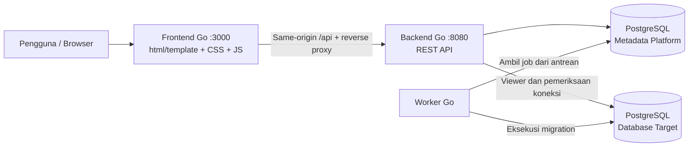

# Terserah — Database Management Platform

Terserah merupakan aplikasi web untuk pengelolaan akses database pada Tugas Besar IF3110 Pengembangan Aplikasi Web — Milestone 1. Aplikasi menyediakan autentikasi, manajemen pengguna dan grup, pengaturan hak akses database, pengelolaan koneksi PostgreSQL, penjelajahan skema dan data, serta pembuatan, eksekusi, dan pelacakan riwayat migration.

## Identitas

Kelas: K2

Kelompok: 06 - Terserah

| Nama | NIM |
|---|---|
| Niko Samuel Simanjuntak | 13524029 |
| An Dafa Anza Avansyah | 13524038 |
| Raymond Jonathan Dwi Putra J | 13524059 |

## Menjalankan Sistem

### Prasyarat

- Go 1.26.2 atau lebih baru.
- PostgreSQL yang berjalan dan dapat diakses dari komputer pengembang.
- Node.js untuk menjalankan tes JavaScript frontend.

Aplikasi dijalankan sebagai dua proses Go: backend pada port `8080` dan frontend pada port `3000`.

### Menjalankan dengan skrip Windows

Dari root repository, jalankan FE dan BE sekaligus dengan satu perintah:

```powershell
.\dev.cmd
```

`dev.cmd` menjalankan `dev.ps1`. Saat `.env` belum tersedia, skrip menawarkan setup PostgreSQL lokal dan meminta akun admin pertama. Untuk database yang sudah ada, siapkan `.env` sesuai bagian manual di bawah. Skrip memuat konfigurasi, menjalankan migration metadata, memeriksa akun admin, lalu menjalankan layanan. Buka `http://localhost:3000/login` dan tekan `Ctrl+C` pada terminal untuk menghentikan layanan yang dimulai oleh skrip.

Pilihan lainnya dari root repository:

```powershell
.\dev.cmd fe      # Jalankan frontend saja; backend harus dijalankan terpisah
.\dev.cmd be      # Jalankan backend saja
.\dev.cmd setup   # Siapkan database lokal baru; hanya jika .env belum ada
.\dev.cmd admin   # Siapkan admin pertama jika belum ada
```

Untuk setup otomatis, PostgreSQL harus berjalan dan `psql` harus tersedia di PATH. Setup membuat database metadata dan dua database target lokal; kredensial target disimpan di `tmp/dev/database-credentials.txt`. Jika nama database atau role yang diperlukan sudah digunakan, setup berhenti tanpa menimpanya. Log layanan berada di `tmp/dev/`.

### Menjalankan secara manual

Langkah berikut menyediakan alternatif untuk menyiapkan database, menjalankan migration, dan menjalankan FE serta BE secara terpisah.

### 1. Siapkan database metadata

Database metadata menyimpan pengguna, grup, grant, konfigurasi koneksi target, draft, dan riwayat migration. Database ini harus terpisah dari database target yang dikelola melalui Terserah.

Jika belum memiliki database metadata, masuk sebagai administrator PostgreSQL:

```powershell
psql -h localhost -U postgres -d postgres
```

Kemudian jalankan sekali di `psql`:

```sql
CREATE ROLE platform LOGIN;
\password platform
CREATE DATABASE platform OWNER platform;
```

Perintah `\password` akan meminta password untuk role `platform`. Jika role/database sudah ada, jangan dibuat ulang; gunakan database yang sudah digunakan sebelumnya. Keluar dengan `\q`.

Untuk menjalankan migration pada database target yang disiapkan secara manual, administrator PostgreSQL perlu menjalankan `BE/sql/provision_target_history.sql` pada setiap target menggunakan `psql` dan role executor terbatas yang sudah ada:

```powershell
psql -h localhost -U <admin_target> -d <database_target> -v executor_role=<role_executor> -f BE/sql/provision_target_history.sql
```

Ganti nilai di dalam tanda `<...>` dengan nama yang sesuai. Role executor harus terpisah dari pemilik database dan memiliki izin yang diperlukan untuk migration. Petunjuk lengkapnya berada pada komentar di awal skrip SQL. Jangan jalankan skrip provisioning melalui draft aplikasi. Setup otomatis `dev.cmd` menyiapkan bagian ini untuk target lokal yang dibuatnya.

### 2. Siapkan environment

Dari root repository:

```powershell
Copy-Item .env.example .env
```

Untuk Linux/macOS:

```bash
cp .env.example .env
```

Atur nilai berikut pada `.env`:

| Variabel | Keterangan |
|---|---|
| `DATABASE_URL` | URL koneksi ke PostgreSQL metadata, misalnya `postgres://platform:<password>@localhost:5432/platform?sslmode=disable` |
| `HTTP_ADDR` | Alamat backend; default `:8080` |
| `APP_ORIGIN` | `http://localhost:3000` untuk FE lokal, bukan `http://localhost:8080` |
| `TARGET_CREDENTIAL_KEY` | Kunci enkripsi Base64 dari 32 byte acak, wajib untuk backend API |
| `FE_HTTP_ADDR` | Opsional, default `:3000` (dibaca proses FE) |
| `FE_BACKEND_URL` | Opsional, default `http://localhost:8080` (dibaca proses FE) |
| `WORKER_EMBEDDED` | Default `true`, API menjalankan dua slot worker. Atur `false` untuk menjalankan worker terpisah. |
| `OTEL_EXPORTER_OTLP_ENDPOINT` | Opsional, kirim trace ke endpoint OTLP/HTTP. Tanpa endpoint, span ditulis ke log JSON. |

`APP_ORIGIN` harus sama persis dengan alamat frontend yang dibuka di browser. Misalnya, `http://localhost:3000` berbeda dari `http://127.0.0.1:3000`. Go tidak otomatis membaca file `.env`; environment harus dimuat ke proses saat menjalankan secara manual.

Jika belum memiliki `TARGET_CREDENTIAL_KEY`, generate satu kali melalui PowerShell:

```powershell
$bytes = New-Object byte[] 32
$rng = [System.Security.Cryptography.RandomNumberGenerator]::Create()
$rng.GetBytes($bytes)
$rng.Dispose()
[Convert]::ToBase64String($bytes)
```

Salin hasilnya ke `.env`. Gunakan kunci yang sama pada setiap restart; penggantian kunci dapat membuat kredensial target yang sudah terenkripsi tidak dapat dibaca. Jangan commit `.env`, password, ataupun kunci enkripsi.

### 3. Jalankan migration metadata

Buka Terminal 1 di root repository dan muat environment backend dari `.env`:

```powershell
Get-Content .env | Where-Object { $_ -match '^(DATABASE_URL|HTTP_ADDR|APP_ORIGIN|TARGET_CREDENTIAL_KEY)=' } | ForEach-Object {
    $name, $value = $_ -split '=', 2
    [Environment]::SetEnvironmentVariable($name, $value, 'Process')
}

cd BE
go run ./cmd/migrate
```

Migration metadata bersifat idempotent sehingga aman dijalankan kembali saat perlu. Jika sebelumnya sudah berhasil dan tidak ada migration baru, tahap ini tidak perlu diulang.

### 4. Buat akun Platform Admin pertama (hanya instalasi baru)

Dari terminal backend yang sama, jika belum ada admin di database metadata:

```powershell
$env:BOOTSTRAP_USERNAME = 'admin'
$secure = Read-Host 'Password admin awal (minimal 12 karakter)' -AsSecureString
$env:BOOTSTRAP_PASSWORD = [System.Net.NetworkCredential]::new('', $secure).Password
go run ./cmd/bootstrap
Remove-Item Env:\BOOTSTRAP_PASSWORD
```

Jangan melakukan bootstrap ulang jika sudah memiliki akun admin. Password login aplikasi berbeda dari password role PostgreSQL.

### 5. Jalankan backend

Masih pada Terminal 1 di direktori `BE/` dengan environment yang sudah dimuat:

```powershell
go run ./cmd/api
```

Backend berjalan pada `http://localhost:8080`. Periksa kesiapan metadata PostgreSQL melalui `http://localhost:8080/health/ready` (status `ok` jika siap).

### 6. Jalankan frontend

Buka Terminal 2 dari root repository:

```powershell
cd FE
$env:FE_HTTP_ADDR = ':3000'
$env:FE_BACKEND_URL = 'http://localhost:8080'
go run .
```

Buka http://localhost:3000/login di browser. Browser mengakses seluruh API melalui origin FE (`localhost:3000`), yang diteruskan oleh reverse proxy ke backend (`localhost:8080`). Gunakan `localhost` secara konsisten, bukan berganti antara `localhost` dan `127.0.0.1`.

### URL Komponen

| Komponen | URL / Port |
|---|---|
| Frontend / Login | http://localhost:3000/login |
| Dashboard | http://localhost:3000/dashboard |
| Admin Users | http://localhost:3000/admin/users |
| Admin Groups | http://localhost:3000/admin/groups |
| Admin Database Connections | http://localhost:3000/admin/databases |
| Admin Grants | http://localhost:3000/admin/grants |
| Backend API | http://localhost:8080/api/v1/ |
| Backend Liveness | http://localhost:8080/health/live |
| Backend Readiness | http://localhost:8080/health/ready |
| PostgreSQL Metadata (contoh) | localhost:5432, database `platform` |

## Arsitektur dan Alur



Frontend merender HTML dengan `html/template`. Router SPA mengambil halaman lewat `fetch()` dan mengganti tampilan tanpa memuat ulang dokumen saat login, logout, dan navigasi internal. API menangani autentikasi, akses target, approval, dan antrean. Worker menjalankan migration dan menyimpan hasilnya.

### Authentication dan Authorization

1. Pengguna login melalui `/login` dengan CSRF prelogin, lalu backend membuat session menggunakan cookie `HttpOnly`.
2. `GET /api/v1/auth/me` digunakan untuk memeriksa session pengguna.
3. Platform Admin mengelola pengguna, grup, keanggotaan, leader, koneksi database, dan grant `view`/`edit`.
4. Pengguna biasa hanya melihat database yang diizinkan berdasarkan grant grupnya.
5. `view` dapat membuka Viewer dan History; `edit` juga dapat mengakses Draft dan Execute Migration.
6. Platform Admin tidak otomatis memiliki akses ke isi database target tanpa grant. Keputusan otorisasi tetap berada di backend.

### Database Viewer dan Migration

1. Admin mendaftarkan koneksi target PostgreSQL melalui `/admin/databases`, menguji koneksi, lalu memberi grant kepada grup melalui `/admin/grants`.
2. Pengguna yang memperoleh grant membuka Viewer untuk melihat schema, tabel, kolom, constraint, index, dan data baris secara *read-only*.
3. Pengguna berizin `edit` dapat membuat atau memperbarui SQL Draft dengan pemeriksaan revision.
4. Pengguna mengajukan revisi untuk ditinjau. Semua leader grup yang punya akses `view` atau `edit` pada target harus menyetujui pengajuan.
5. Pengguna `edit` mengirim revisi yang disetujui ke antrean. API merespons `202 Accepted` dengan ID job. Worker memeriksa ulang izin dan approval, lalu mengeksekusi migration. Halaman Jobs menampilkan progres.
6. History menampilkan hasil dan detail eksekusi. Rollback, forward, dan resume batch mengikuti alur review dan antrean yang sama. Untuk hasil yang belum pasti, Reconcile memeriksa receipt di target dan memperbarui status.

### Menjalankan Worker Terpisah

API sudah menjalankan worker secara bawaan. Untuk memisahkan proses, atur `WORKER_EMBEDDED=false` sebelum menyalakan API. Di terminal worker, muat `DATABASE_URL` dan `TARGET_CREDENTIAL_KEY` yang sama, lalu jalankan dari folder `BE/`:

```powershell
go run ./cmd/worker
```

## Fitur Utama

| Area | Fitur |
|---|---|
| Autentikasi | Login, logout, session cookie, CSRF |
| Administrasi | Manajemen user, group, membership, leader, dan grant `view`/`edit` |
| Target PostgreSQL | Daftar, tambah, ubah, hapus, dan test koneksi |
| Database Viewer | Schema, table, column, constraint, index, data baris, pagination |
| Migration Draft | Membuat, membaca, mengubah draft SQL dan revision checking |
| Review dan Jobs | Approval per grup, antrean, pemantauan status dan progres |
| Execute Migration | SQL transaksional, batch dengan checkpoint, rollback, forward, dan resume |
| History | Daftar/detail riwayat, cursor pagination, SQL detail, status eksekusi |
| Reconciliation | Pemeriksaan eksplisit status `running`/`unknown` bagi pengguna berizin `edit` |

## Keputusan Teknis

### Go Templates dan JavaScript ES Modules

Frontend menggunakan Go `html/template` untuk penyajian HTML, vanilla JavaScript ES Modules untuk interaksi, serta CSS untuk tampilan. Asset disematkan ke binary FE melalui `//go:embed templates static`, sehingga perubahan template, CSS, atau JavaScript memerlukan build dan restart FE.

### Same-Origin Reverse Proxy

Server FE meneruskan `/api/` dan `/health/` ke BE. Browser mengirim cookie session dengan `credentials: "same-origin"`; CSRF token disertakan pada request mutasi. Session tidak disimpan dalam `localStorage`.

### Kontrol Akses dan Keamanan Data

Backend memvalidasi permission untuk setiap operasi. Frontend menyesuaikan navigasi berdasarkan grant untuk UX, bukan sebagai pengganti pemeriksaan backend. Nilai database ditampilkan menggunakan DOM API yang aman, bukan menyisipkan konten tidak tepercaya ke `innerHTML`. Identifier besar dikirim sebagai string.

### Migration dan Recovery

Migration dijalankan pada database target yang berbeda dari metadata, dengan role executor PostgreSQL terbatas. Administrator database menyiapkan schema riwayat target. Worker memakai receipt untuk memulihkan hasil commit dan checkpoint untuk melanjutkan batch dari posisi terakhir. Pengguna berizin `edit` juga bisa menjalankan Reconcile dari halaman History.

### Log dan Trace

Contoh ringkas log pengajuan review dan span HTTP dengan ID yang sama:

```jsonl
{"level":"INFO","event":"migration_review_submitted","actor_id":3,"database_id":1,"review_id":42,"status":"pending_review","trace_id":"0123456789abcdef0123456789abcdef","span_id":"0123456789abcdef"}
{"level":"INFO","event":"trace_span","name":"POST /api/v1/databases/{id}/reviews","trace_id":"0123456789abcdef0123456789abcdef","span_id":"0123456789abcdef","duration_ms":12}
```

Untuk eksekusi, gunakan `trace_id` dari permintaan antrekan untuk menemukan span worker. Log SQL mencatat hash query, durasi, dan hasil dengan nilai parameter disamarkan.

## Technology Stack

| Area | Teknologi |
|---|---|
| Backend | Go 1.26.0, `net/http` |
| Frontend | Go 1.26.2, `html/template`, `net/http` |
| Client-side | Vanilla JavaScript ES Modules |
| Styling | HTML5, CSS3 |
| Database | PostgreSQL |
| PostgreSQL driver | `github.com/jackc/pgx/v5` |
| Komunikasi FE–BE | REST API JSON melalui reverse proxy |
| Authentication | Session cookie HttpOnly dan CSRF token |
| Testing | Go `testing`, `go vet`, Node.js built-in test runner |

## Struktur Repository

```text
.
├── .env.example
├── BE/
│   ├── cmd/
│   │   ├── api/               # HTTP API
│   │   ├── migrate/           # Migration metadata
│   │   ├── bootstrap/         # Admin pertama
│   │   └── seed/              # CLI kompatibilitas bootstrap
│   ├── internal/
│   │   ├── auth/              # Session, login, CSRF
│   │   ├── admin/             # User, group, membership, grant
│   │   ├── connections/       # Koneksi target dan enkripsi kredensial
│   │   ├── viewer/            # Schema dan data viewer
│   │   ├── runner/            # Draft, execute, history, reconcile
│   │   └── ...
│   ├── migrations/            # SQL metadata platform
│   ├── sql/                   # Provision migration history target
│   ├── demo/                  # Contoh SQL migration
│   └── tests/                 # Integration dan smoke tests
├── FE/
│   ├── main.go
│   ├── internal/
│   │   ├── config/
│   │   └── web/
│   │       ├── server.go      # Routing dan reverse proxy
│   │       ├── pages.go       # Render Go template
│   │       ├── templates/     # Layout dan halaman
│   │       └── static/        # CSS dan JavaScript ES Modules
│   └── test/                  # JavaScript tests
└── tests/                     # Test pendukung repository
```

## Daftar Endpoint Utama

Semua endpoint API diakses oleh browser melalui `http://localhost:3000/api/v1/...` dan diteruskan ke BE.

### Authentication dan Administrasi

| Method | Endpoint | Fungsi |
|---|---|---|
| GET | `/api/v1/auth/csrf` | Mendapatkan CSRF token |
| POST | `/api/v1/auth/login` | Login |
| GET | `/api/v1/auth/me` | Informasi pengguna aktif |
| POST | `/api/v1/auth/logout` | Logout |
| GET / POST | `/api/v1/admin/users` | Daftar / tambah pengguna |
| PATCH | `/api/v1/admin/users/{id}` | Ubah pengguna |
| GET / POST | `/api/v1/admin/groups` | Daftar / buat grup |
| PUT | `/api/v1/admin/groups/{id}/leader` | Tetapkan leader grup |
| PUT / DELETE | `/api/v1/admin/groups/{id}/users/{userID}` | Atur anggota grup |
| PUT / DELETE | `/api/v1/admin/groups/{id}/databases/{databaseID}` | Atur / cabut grant |
| GET / POST | `/api/v1/admin/databases` | Daftar / tambah koneksi target |
| PATCH / DELETE | `/api/v1/admin/databases/{id}` | Ubah / hapus koneksi |
| POST | `/api/v1/admin/databases/{id}/test` | Uji koneksi target |
| GET | `/api/v1/databases` | Database yang dapat diakses pengguna |

### Viewer, Draft, dan Migration

| Method | Endpoint | Fungsi |
|---|---|---|
| GET | `/api/v1/databases/{id}/schemas` | Daftar schema |
| GET | `/api/v1/databases/{id}/schemas/{schema}/tables` | Daftar tabel |
| GET | `/api/v1/databases/{id}/schemas/{schema}/tables/{table}` | Metadata tabel |
| GET | `/api/v1/databases/{id}/schemas/{schema}/tables/{table}/rows` | Data tabel dan pagination |
| GET / POST | `/api/v1/databases/{id}/drafts` | Daftar / tambah draft |
| GET / PATCH | `/api/v1/databases/{id}/drafts/{draftID}` | Detail / ubah draft |
| GET | `/api/v1/reviews` | Daftar review lintas database dengan filter dan cursor |
| GET / POST | `/api/v1/databases/{id}/reviews` | Daftar / ajukan review pada database target |
| POST | `/api/v1/databases/{id}/reviews/{reviewID}/approve` | Setujui pengajuan |
| POST | `/api/v1/databases/{id}/reviews/{reviewID}/reject` | Tolak pengajuan dengan alasan |
| GET / POST | `/api/v1/databases/{id}/jobs` | Daftar / antrekan job dari review |
| GET | `/api/v1/databases/{id}/jobs/{jobID}` | Status, progres, dan percobaan job |
| POST | `/api/v1/databases/{id}/drafts/{draftID}/execute` | Antrekan eksekusi revisi yang disetujui |
| POST | `/api/v1/databases/{id}/drafts/{draftID}/explain` | Analisis query draft tersimpan |
| GET | `/api/v1/databases/{id}/migrations` | Daftar history |
| GET | `/api/v1/databases/{id}/migrations/{version}` | Detail history |
| POST | `/api/v1/databases/{id}/migrations/reconcile` | Reconcile status ambigu |

Daftar review menerima `limit`, `before`, `status`, dan `only_actionable`. Gunakan nilai `next_before` dari respons sebagai cursor berikutnya. Halaman pertama dengan `only_actionable=true` juga mengembalikan `total` review yang cocok.

## Pengujian

Jalankan dari `BE/`:

```powershell
go test ./...
go vet ./...
```

Jalankan dari `FE/`:

```powershell
go test ./...
go vet ./...
node --test
```

### Tes Integrasi Backend

Siapkan PostgreSQL khusus pengujian sesuai [fixture CI](.github/workflows/backend.yml), lalu isi `TEST_DATABASE_URL`, `TEST_TARGET_DATABASE_URL`, `TEST_SECOND_TARGET_DATABASE_URL`, dan `TEST_TARGET_ADMIN_DATABASE_URL` pada terminal. Dari `BE/` jalankan:

```powershell
go test -p 1 -tags=integration ./... -count=1 -timeout=1200s
```

### Perbandingan UPDATE Tunggal dan Batch

Dengan fixture yang sama, jalankan:

```powershell
go test -tags='integration batchdemo' ./tests/integration -run '^TestBatchPerformanceComparison$' -count=1 -v
```

Tes membuat dua tabel identik dengan 120.000 baris dan indeks ekspresi. UPDATE tunggal diukur dari pengiriman SQL sampai commit. Jalur batch diukur dari worker mengambil job hingga selesai, termasuk penyimpanan snapshot dan checkpoint. Keduanya diverifikasi mengubah 120.000 baris. Batch membagi pekerjaan menjadi 24 commit terpisah agar progres dapat dipantau dan dilanjutkan dari checkpoint.

Hasil satu kali pengukuran di Windows 11, Intel Core Ultra 5 225H, PostgreSQL 18.6 lokal:

| Jalur | Durasi |
|---|---:|
| UPDATE tunggal | 6,393 detik |
| Batch via worker | 16,875 detik |

Untuk mendemokan pemulihan setelah satu batch berhasil commit, jalankan `TestLargeBatchApprovedResumePreservesCommittedPrefixAndFrozenScope` dengan tag `integration`.

## Bonus dan Batasan

### Schema Diff dan Migration Generation

Pada halaman Draft, pengguna dengan grant `edit` dapat membandingkan dua schema dalam database target yang sama. Aplikasi menampilkan perbedaan dan kandidat SQL yang dapat dimasukkan ke draft baru; proses perbandingan tidak menjalankan SQL.

Generator mendukung pembuatan tabel biasa dengan tipe kolom sederhana dan penambahan kolom nullable tanpa default. Penghapusan, perubahan kolom yang sudah ada, constraint, index, dan atribut atau tipe tertentu tidak dibuat otomatis. Perbandingan dibatasi hingga 100 tabel per schema. Tinjau peringatan dan SQL sebelum menjalankan migration.

### Query Execution Plan Analysis

Pengguna dengan grant `edit` dapat memilih **Analisis Query** pada draft yang sudah disimpan. Backend mengirim `EXPLAIN (FORMAT JSON)` ke PostgreSQL dan menampilkan rencana untuk setiap statement.

Hasilnya merupakan perkiraan PostgreSQL, bukan waktu eksekusi aktual: fitur ini tidak menggunakan `EXPLAIN ANALYZE`. Setiap statement diperiksa secara terpisah dalam transaksi read-only, sehingga perubahan dari statement sebelumnya tidak tersedia untuk statement berikutnya. PostgreSQL juga dapat menolak statement yang tidak mendukung `EXPLAIN`.
