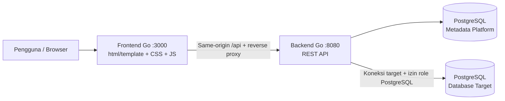

# Terserah — Database Management Platform

Terserah merupakan aplikasi web untuk pengelolaan akses database pada Tugas Besar IF3110 Pengembangan Aplikasi Web — Milestone 1. Aplikasi menyediakan autentikasi, manajemen pengguna dan grup, pengaturan hak akses database, pengelolaan koneksi PostgreSQL, penjelajahan skema dan data, serta pembuatan, eksekusi, dan pelacakan riwayat migration.

## Identitas

Kelas: K2

Kelompok: Terserah

| Nama | NIM |
|---|---|
| Niko Samuel Simanjuntak | 13524029 |
| An Dafa Anza Avansyah | 13524038 |
| Raymond Jonathan Dwi Putra J | 13524059 |

## Menjalankan Sistem

### Prasyarat

- Go 1.26.2 atau lebih baru.
- PostgreSQL yang berjalan dan dapat diakses dari komputer pengembang.

Aplikasi dijalankan sebagai dua proses Go: backend pada port `8080` dan frontend pada port `3000`.

### 1. Siapkan database metadata

Database metadata menyimpan pengguna, grup, grant, konfigurasi koneksi target, draft, dan riwayat migration. Database ini harus terpisah dari database target yang dikelola melalui Terserah.

Jika belum memiliki database metadata, masuk sebagai administrator PostgreSQL:

```powershell
psql -h localhost -U postgres -d postgres
```

Kemudian jalankan sekali di `psql`:

```sql
CREATE ROLE platform LOGIN;
\password platform
CREATE DATABASE platform OWNER platform;
```

Perintah `\password` akan meminta password untuk role `platform`. Jika role/database sudah ada, jangan dibuat ulang; gunakan database yang sudah digunakan sebelumnya. Keluar dengan `\q`.

### 2. Siapkan environment

Dari root repository:

```powershell
Copy-Item .env.example .env
```

Untuk Linux/macOS:

```bash
cp .env.example .env
```

Atur nilai berikut pada `.env`:

| Variabel | Keterangan |
|---|---|
| `DATABASE_URL` | URL koneksi ke PostgreSQL metadata, misalnya `postgres://platform:<password>@localhost:5432/platform?sslmode=disable` |
| `HTTP_ADDR` | Alamat backend; default `:8080` |
| `APP_ORIGIN` | `http://localhost:3000` untuk FE lokal, bukan `http://localhost:8080` |
| `TARGET_CREDENTIAL_KEY` | Kunci enkripsi Base64 dari 32 byte acak, wajib untuk backend API |
| `FE_HTTP_ADDR` | Opsional, default `:3000` (dibaca proses FE) |
| `FE_BACKEND_URL` | Opsional, default `http://localhost:8080` (dibaca proses FE) |

Penting: `.env.example` masih mencantumkan `APP_ORIGIN=http://localhost:8080`. Ubah menjadi `http://localhost:3000` jika browser mengakses FE pada port `3000`. Go tidak otomatis membaca file `.env`; environment harus dimuat ke proses.

Jika belum memiliki `TARGET_CREDENTIAL_KEY`, generate satu kali melalui PowerShell:

```powershell
$bytes = New-Object byte[] 32
$rng = [System.Security.Cryptography.RandomNumberGenerator]::Create()
$rng.GetBytes($bytes)
$rng.Dispose()
[Convert]::ToBase64String($bytes)
```

Salin hasilnya ke `.env`. Gunakan kunci yang sama pada setiap restart; penggantian kunci dapat membuat kredensial target yang sudah terenkripsi tidak dapat dibaca. Jangan commit `.env`, password, ataupun kunci enkripsi.

### 3. Jalankan migration metadata

Buka Terminal 1 di root repository dan muat environment backend dari `.env`:

```powershell
Get-Content .env | Where-Object { $_ -match '^(DATABASE_URL|HTTP_ADDR|APP_ORIGIN|TARGET_CREDENTIAL_KEY)=' } | ForEach-Object {
    $name, $value = $_ -split '=', 2
    [Environment]::SetEnvironmentVariable($name, $value, 'Process')
}

cd BE
go run ./cmd/migrate
```

Migration metadata bersifat idempotent sehingga aman dijalankan kembali saat perlu. Jika sebelumnya sudah berhasil dan tidak ada migration baru, tahap ini tidak perlu diulang.

### 4. Buat akun Platform Admin pertama (hanya instalasi baru)

Dari terminal backend yang sama, jika belum ada admin di database metadata:

```powershell
$env:BOOTSTRAP_USERNAME = 'admin'
$secure = Read-Host 'Password admin awal (minimal 12 karakter)' -AsSecureString
$env:BOOTSTRAP_PASSWORD = [System.Net.NetworkCredential]::new('', $secure).Password
go run ./cmd/bootstrap
Remove-Item Env:\BOOTSTRAP_PASSWORD
```

Jangan melakukan bootstrap ulang jika sudah memiliki akun admin. Password login aplikasi berbeda dari password role PostgreSQL.

### 5. Jalankan backend

Masih pada Terminal 1 di direktori `BE/` dengan environment yang sudah dimuat:

```powershell
go run ./cmd/api
```

Backend berjalan pada `http://localhost:8080`. Periksa kesiapan metadata PostgreSQL melalui `http://localhost:8080/health/ready` (status `ok` jika siap).

### 6. Jalankan frontend

Buka Terminal 2 dari root repository:

```powershell
cd FE
$env:FE_HTTP_ADDR = ':3000'
$env:FE_BACKEND_URL = 'http://localhost:8080'
go run .
```

Buka http://localhost:3000/login di browser. Browser mengakses seluruh API melalui origin FE (`localhost:3000`), yang diteruskan oleh reverse proxy ke backend (`localhost:8080`). Gunakan `localhost` secara konsisten, bukan berganti antara `localhost` dan `127.0.0.1`.

### URL Komponen

| Komponen | URL / Port |
|---|---|
| Frontend / Login | http://localhost:3000/login |
| Dashboard | http://localhost:3000/dashboard |
| Admin Users | http://localhost:3000/admin/users |
| Admin Groups | http://localhost:3000/admin/groups |
| Admin Database Connections | http://localhost:3000/admin/databases |
| Admin Grants | http://localhost:3000/admin/grants |
| Backend API | http://localhost:8080/api/v1/ |
| Backend Liveness | http://localhost:8080/health/live |
| Backend Readiness | http://localhost:8080/health/ready |
| PostgreSQL Metadata (contoh) | localhost:5432, database `platform` |

## Arsitektur dan Alur



Frontend merender kerangka halaman menggunakan `html/template`; JavaScript ES Modules menggunakan `fetch()` untuk memanggil REST API dan memperbarui DOM tanpa memuat ulang seluruh halaman. Backend menangani autentikasi, otorisasi, penyimpanan metadata, koneksi target, pembacaan schema/data, serta eksekusi migration.

### Authentication dan Authorization

1. Pengguna login melalui `/login` dengan CSRF prelogin, lalu backend membuat session menggunakan cookie `HttpOnly`.
2. `GET /api/v1/auth/me` digunakan untuk memeriksa session pengguna.
3. Platform Admin mengelola pengguna, grup, keanggotaan grup, koneksi database, dan grant akses `view`/`edit`.
4. Pengguna biasa hanya melihat database yang diizinkan berdasarkan grant grupnya.
5. `view` dapat membuka Viewer dan History; `edit` juga dapat mengakses Draft dan Execute Migration.
6. Platform Admin tidak otomatis memiliki akses ke isi database target tanpa grant. Keputusan otorisasi tetap berada di backend.

### Database Viewer dan Migration

1. Admin mendaftarkan koneksi target PostgreSQL melalui `/admin/databases`, menguji koneksi, lalu memberi grant kepada grup melalui `/admin/grants`.
2. Pengguna yang memperoleh grant membuka Viewer untuk melihat schema, tabel, kolom, constraint, index, dan data baris secara *read-only*.
3. Pengguna berizin `edit` dapat membuat atau memperbarui SQL Draft dengan pemeriksaan revision.
4. Sebelum Execute Migration, pengguna meninjau draft tersimpan dan mengonfirmasi eksekusi. Backend mengeksekusi SQL dalam transaksi.
5. Hasil `success` menandakan COMMIT, `failed` menandakan ROLLBACK, sedangkan `running`/`unknown` belum definitif.
6. History menyimpan status, version, pelaksana, dan detail SQL. Pengguna `edit` dapat menjalankan Reconcile secara eksplisit untuk status ambigu tanpa mengeksekusi ulang SQL.

## Fitur Utama

| Area | Fitur |
|---|---|
| Autentikasi | Login, logout, session cookie, CSRF |
| Administrasi | Manajemen user, group, membership, serta grant `view`/`edit` |
| Target PostgreSQL | Daftar, tambah, ubah, hapus, dan test koneksi |
| Database Viewer | Schema, table, column, constraint, index, data baris, pagination |
| Migration Draft | Membuat, membaca, mengubah draft SQL dan revision checking |
| Execute Migration | Konfirmasi, eksekusi SQL transaksional, status hasil dan penanganan konflik |
| History | Daftar/detail riwayat, cursor pagination, SQL detail, status eksekusi |
| Reconciliation | Pemeriksaan eksplisit status `running`/`unknown` bagi pengguna berizin `edit` |

## Keputusan Teknis

### Go Templates dan JavaScript ES Modules

Frontend menggunakan Go `html/template` untuk penyajian HTML, vanilla JavaScript ES Modules untuk interaksi, serta CSS untuk tampilan. Asset disematkan ke binary FE melalui `//go:embed templates static`.

### Same-Origin Reverse Proxy

Server FE meneruskan `/api/` dan `/health/` ke BE. Browser mengirim cookie session dengan `credentials: "same-origin"`; CSRF token disertakan pada request mutasi. Session tidak disimpan dalam `localStorage`.

### Kontrol Akses dan Keamanan Data

Backend memvalidasi permission untuk setiap operasi. Frontend menyesuaikan navigasi berdasarkan grant untuk UX, bukan sebagai pengganti pemeriksaan backend. Nilai database ditampilkan menggunakan DOM API yang aman, bukan menyisipkan konten tidak tepercaya ke `innerHTML`. Identifier besar dikirim sebagai string.

### Migration dan Recovery

Migration dijalankan pada database target yang berbeda dari metadata, dengan role executor PostgreSQL terbatas. Riwayat target perlu diprovision oleh administrator database; status `unknown` atau koneksi terputus tidak memicu retry otomatis. Reconcile adalah aksi tersendiri untuk memastikan status eksekusi.

## Technology Stack

| Area | Teknologi |
|---|---|
| Backend | Go 1.26.0, `net/http` |
| Frontend | Go 1.26.2, `html/template`, `net/http` |
| Client-side | Vanilla JavaScript ES Modules |
| Styling | HTML5, CSS3 |
| Database | PostgreSQL |
| PostgreSQL driver | `github.com/jackc/pgx/v5` |
| Komunikasi FE–BE | REST API JSON melalui reverse proxy |
| Authentication | Session cookie HttpOnly dan CSRF token |
| Testing | Go `testing`, `go vet`, Node.js built-in test runner |

## Struktur Repository

```text
.
├── .env.example
├── BE/
│   ├── cmd/
│   │   ├── api/               # HTTP API
│   │   ├── migrate/           # Migration metadata
│   │   ├── bootstrap/         # Admin pertama
│   │   └── seed/              # CLI kompatibilitas bootstrap
│   ├── internal/
│   │   ├── auth/              # Session, login, CSRF
│   │   ├── admin/             # User, group, membership, grant
│   │   ├── connections/       # Koneksi target dan enkripsi kredensial
│   │   ├── viewer/            # Schema dan data viewer
│   │   ├── runner/            # Draft, execute, history, reconcile
│   │   └── ...
│   ├── migrations/            # SQL metadata platform
│   ├── sql/                   # Provision migration history target
│   ├── demo/                  # Contoh SQL migration
│   └── tests/                 # Integration dan smoke tests
├── FE/
│   ├── main.go
│   ├── internal/
│   │   ├── config/
│   │   └── web/
│   │       ├── server.go      # Routing dan reverse proxy
│   │       ├── pages.go       # Render Go template
│   │       ├── templates/     # Layout dan halaman
│   │       └── static/        # CSS dan JavaScript ES Modules
│   └── test/                  # JavaScript tests
└── tests/                     # Test pendukung repository
```

## Daftar Endpoint Utama

Semua endpoint API diakses oleh browser melalui `http://localhost:3000/api/v1/...` dan diteruskan ke BE.

### Authentication dan Administrasi

| Method | Endpoint | Fungsi |
|---|---|---|
| GET | `/api/v1/auth/csrf` | Mendapatkan CSRF token |
| POST | `/api/v1/auth/login` | Login |
| GET | `/api/v1/auth/me` | Informasi pengguna aktif |
| POST | `/api/v1/auth/logout` | Logout |
| GET / POST | `/api/v1/admin/users` | Daftar / tambah pengguna |
| PATCH | `/api/v1/admin/users/{id}` | Ubah pengguna |
| GET / POST | `/api/v1/admin/groups` | Daftar / buat grup |
| PUT / DELETE | `/api/v1/admin/groups/{id}/users/{userID}` | Atur anggota grup |
| PUT / DELETE | `/api/v1/admin/groups/{id}/databases/{databaseID}` | Atur / cabut grant |
| GET / POST | `/api/v1/admin/databases` | Daftar / tambah koneksi target |
| PATCH / DELETE | `/api/v1/admin/databases/{id}` | Ubah / hapus koneksi |
| POST | `/api/v1/admin/databases/{id}/test` | Uji koneksi target |
| GET | `/api/v1/databases` | Database yang dapat diakses pengguna |

### Viewer, Draft, dan Migration

| Method | Endpoint | Fungsi |
|---|---|---|
| GET | `/api/v1/databases/{id}/schemas` | Daftar schema |
| GET | `/api/v1/databases/{id}/schemas/{schema}/tables` | Daftar tabel |
| GET | `/api/v1/databases/{id}/schemas/{schema}/tables/{table}` | Metadata tabel |
| GET | `/api/v1/databases/{id}/schemas/{schema}/tables/{table}/rows` | Data tabel dan pagination |
| GET / POST | `/api/v1/databases/{id}/drafts` | Daftar / tambah draft |
| GET / PATCH | `/api/v1/databases/{id}/drafts/{draftID}` | Detail / ubah draft |
| POST | `/api/v1/databases/{id}/drafts/{draftID}/execute` | Execute migration |
| GET | `/api/v1/databases/{id}/migrations` | Daftar history |
| GET | `/api/v1/databases/{id}/migrations/{version}` | Detail history |
| POST | `/api/v1/databases/{id}/migrations/reconcile` | Reconcile status ambigu |

## Pengujian

Jalankan dari `BE/`:

```powershell
go test ./...
go vet ./...
```

Jalankan dari `FE/`:

```powershell
go test ./...
go vet ./...
node --test
```

## Bonus dan Batasan
??