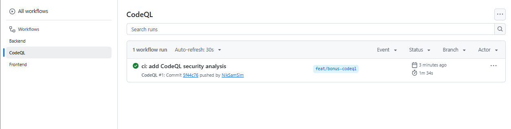
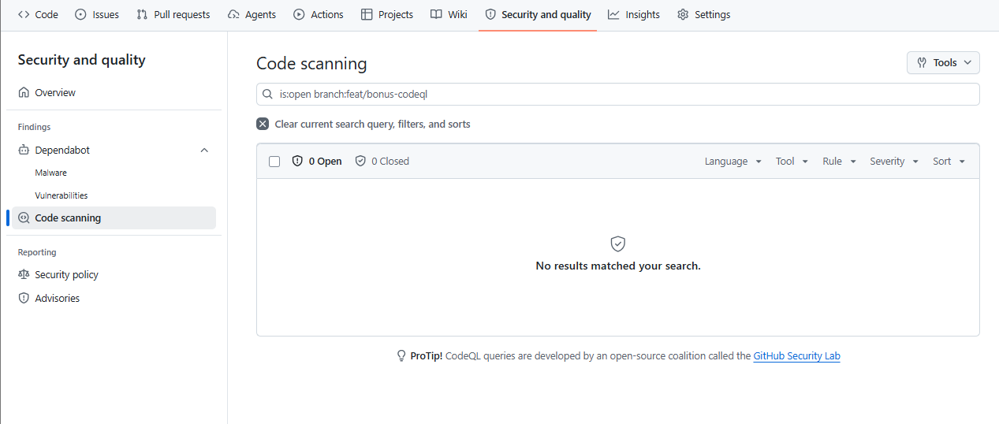
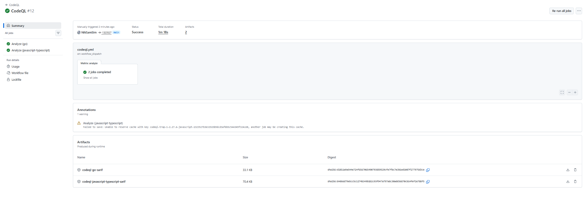
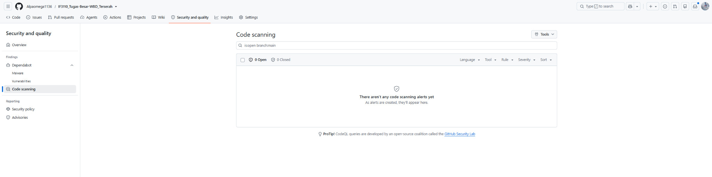

# Security: SAST dengan CodeQL

## Konfigurasi analisis

Static Application Security Testing (SAST) dilakukan menggunakan CodeQL melalui GitHub Actions dengan workflow [`.github/workflows/codeql.yml`](../../.github/workflows/codeql.yml). Workflow menggunakan Advanced Setup dengan default query suite, manual build (`go build ./...`) pada kedua modul Go (`BE/` dan `FE/`), serta `build-mode: none` untuk JavaScript/TypeScript.

Workflow dipicu oleh push pada `main`, `ml2/main`, dan `feat/bonus-codeql`, pull request menuju `main` atau `ml2/main`, serta `workflow_dispatch`. Artifact SARIF diunggah untuk masing-masing bahasa setelah analisis berhasil.

## Hasil initial scan dan final scan

Initial scan merupakan pengukuran awal sebelum integrasi bonus k6 dan observability. Final scan menganalisis source code setelah kedua bonus tersebut terintegrasi pada `main`.

| Informasi | Initial scan | Final scan |
|---|---|---|
| Tanggal | 26 November 2026 | 26 November 2026 |
| Branch | `feat/bonus-codeql` | `main` |
| Commit | `5f44c76` | `1323527` |
| Workflow run | CodeQL #1 | CodeQL #12 |
| Durasi workflow | 1 menit 34 detik | 1 menit 18 detik |
| Versi CodeQL | 2.27.6 | 2.27.6 |
| Versi SARIF | 2.1.0 | 2.1.0 |

Branch, commit, nomor run, dan durasi diperoleh dari tangkapan layar GitHub Actions. Versi CodeQL, hasil analisis, dan cakupan ekstraksi diperoleh dari metadata artifact SARIF.

| Analisis | Status initial | Baris kode initial | Temuan initial | Status final | Baris kode final | Temuan final |
|---|---|---:|---:|---|---:|---:|
| Go | Berhasil | 9.811 | 0 | Berhasil | 10.183 | 0 |
| JavaScript/TypeScript | Berhasil | 6.983 | 0 | Berhasil | 7.478 | 0 |

Pada kedua scan, `executionSuccessful` bernilai `true` dan array `results` kosong untuk masing-masing bahasa. Tidak terdapat notifikasi berlevel `warning` atau `error` pada artifact SARIF. Halaman Code scanning untuk masing-masing branch menampilkan 0 open alerts dan 0 closed alerts pada saat bukti diambil.

Workflow final memiliki satu anotasi warning terkait kegagalan reservasi cache JavaScript/TypeScript (`Unable to reserve cache ... another job may be creating this cache`). Warning tersebut berkaitan dengan penyimpanan cache, bukan hasil query keamanan. Kedua job analisis tetap berstatus berhasil dan kedua artifact SARIF tersedia.

## Cakupan analisis

| Komponen | Initial: file diekstraksi | Final: file diekstraksi |
|---|---:|---:|
| Go backend (`BE/`) | 61 | 64 |
| Go frontend (`FE/`) | 4 | 4 |
| Go module manifest | 2 | 2 |
| JavaScript aplikasi frontend (`.js`) | 22 | 22 |
| JavaScript test dan fixture frontend (`.mjs`) | 15 | 15 |
| Script k6 (`tests/k6/`, `.js`) | 0 | 6 |
| HTML template | 12 | 12 |
| YAML pada ekstraksi JavaScript | 3 | 10 |

Cakupan diperoleh dari notifikasi `successfully-extracted-files` pada SARIF. Seluruh 65 file Go non-test dan 37 file JavaScript/MJS pada snapshot initial berhasil diekstraksi. Pada snapshot final, seluruh 68 file Go non-test dan 43 file JavaScript/MJS berhasil diekstraksi. Kedua analisis mencatat 12 HTML template yang sama, sehingga tidak dihitung dua kali. Pada final scan, ekstraksi YAML mencakup tiga workflow GitHub Actions, konfigurasi Docker Compose observability, dan enam file konfigurasi observability lainnya.

Baris kode terukur menggunakan metrik SARIF `go/summary/lines-of-code` dan `js/summary/lines-of-code`. Ekstraksi file tidak berarti setiap file atau setiap baris diperiksa oleh semua query keamanan. Ekstraksi YAML juga bukan bukti audit keamanan lengkap terhadap konfigurasi infrastruktur.

Contoh query yang tercantum pada metadata SARIF meliputi `go/sql-injection`, `go/command-injection`, `go/clear-text-logging`, `go/cookie-httponly-not-set`, `go/cookie-secure-not-set`, `js/xss`, `js/sql-injection`, `js/path-injection`, dan `js/clear-text-logging`.

## Temuan dan tindak lanjut

Initial scan dan final scan tidak menghasilkan temuan keamanan. Oleh karena itu, tidak terdapat rule, severity, lokasi, atau dampak temuan yang perlu didokumentasikan per kasus. Tidak ada temuan yang diperbaiki, di-dismiss sebagai false positive, maupun diterima sebagai risiko.

Final scan merupakan verifikasi terhadap perubahan source code setelah initial scan, bukan scan ulang akibat perbaikan temuan. Penambahan kode observability dan script pengujian k6 telah tercakup pada ekstraksi final.

## Bukti hasil scan

### Initial scan — CodeQL #1

- [Screenshot workflow berhasil](evidence/workflow-success.png)
- [Screenshot Code scanning alerts](evidence/code-scanning-alerts.png)
- [Artifact SARIF Go](evidence/codeql-go-sarif.zip)
- [Artifact SARIF JavaScript/TypeScript](evidence/codeql-javascript-typescript-sarif.zip)

### Final scan — CodeQL #12

- [Screenshot workflow berhasil](evidence/final-scan/workflow-success.png)
- [Screenshot Code scanning alerts](evidence/final-scan/code-scanning-alerts.png)
- [Artifact SARIF Go](evidence/final-scan/codeql-go-sarif.zip)
- [Artifact SARIF JavaScript/TypeScript](evidence/final-scan/codeql-javascript-typescript-sarif.zip)

## Reproduksi analisis

Analisis dapat direproduksi melalui trigger push atau pull request yang ditetapkan dalam workflow maupun melalui menu Actions → CodeQL → Run workflow dengan branch yang sesuai. Halaman Summary menyediakan status kedua job dan artifact SARIF. Halaman Security and quality → Code scanning menyediakan daftar alert dengan filter branch terkait. Jumlah temuan diverifikasi dari `runs[].results` di dalam SARIF, bukan hanya status keberhasilan workflow.

## Batasan

Hasil scan bersih tidak berarti aplikasi pasti aman. Analisis terbatas pada commit yang disebutkan, file yang berhasil diekstraksi, dan query yang digunakan. Manual build menggunakan `go build ./...`; 71 file Go `_test.go` pada snapshot initial dan 73 file pada snapshot final tidak ikut diekstraksi. Analisis ini bukan DAST, audit manual menyeluruh, maupun pemeriksaan lengkap terhadap konfigurasi deployment dan seluruh dependency.
